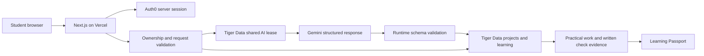

# Architecture checkpoint

## Foundation

One Next.js application contains the UI and authenticated server services. Pages render the learning experience; reusable components implement navigation and presentation. Domain types derive from Zod contracts where appropriate, so runtime and TypeScript validation agree.

The same Next.js application runs on Vercel. No separate backend, microservices, or additional sponsor service is introduced.

## Service boundaries

- Project service: intake, validated roadmap generation, milestone progress.
- AI service: Gemini requests, structured-output validation, hint-first tutoring, bounded context, model failure handling.
- Passport service: canonical skill matching, evidence, student review preferences.
- Authentication: server-managed Auth0 session; stable identity as the record owner.
- Database: Drizzle against Tiger Data PostgreSQL; migrations after schema review.

Gemini, project storage, Passport, authentication, and database boundaries are implemented. The current verification record is in BUILD_STATUS.md.

## Phase 2 implementation

The intake client posts validated project details to `/api/roadmaps`. The Node route keeps credentials private, checks the incoming origin, bounds request size, validates input, and calls the Gemini service. The service requests structured JSON with a small provider-compatible schema, then enforces the full Zod schema, ordered dependencies, canonical skill membership, and the student's total time budget. Official resources come from the application catalog; AI claims of verification are discarded.

No retry silently spends additional quota. The student chooses when to retry. Provider failures return safe messages rather than raw API responses. A timeout bounds each generation attempt. Phase 4 now requires authenticated access in development and production.

The `ProjectStore` interface exposes `saveProject`, `loadProject`, and `listProjects`. The remote adapter now connects these UI calls to authenticated APIs and ownership-scoped database operations. The legacy session adapter remains for preserving and explicitly importing earlier browser projects.

The Field Notes design uses shared color, typography, spacing, and control tokens in `studio.css`. Canonical skill states have both text labels and distinct colors; no color alone conveys mastery.

## Evidence and student ownership

AI recommendations are separate from student submissions and application completion records. Verified assessment results must come from an actual check. The tutor must not claim execution or mastery it cannot support.

Project progress remains project-specific. Skipping an introductory lesson never completes the implementation task. Reading a lesson does not earn mastery. The owner approved saved practical work plus student confirmation for practice, with a passed targeted check additionally required for mastery.

Future data operations must derive the owner from the server-authenticated identity and check ownership on reads and writes. Client-submitted owner IDs must not authorize access.

## Configuration

Variables are documented in `.env.example`: Gemini API key and chosen model, PostgreSQL connection URL, Auth0 domain/client ID/client secret/session secret, and application base URL. Auth0 login and Tiger Data connection/migration have been verified. The owner approved Gemini 3.7 Flash after repeated 3.8 failures. Current live-test results and provider availability limitations are recorded in BUILD_STATUS.md.

## Phase 3 learning boundary

`/api/learning` validates bounded requests and calls `src/lib/ai/learning.ts`. Lessons, tutor replies, and assessment reviews have separate structured schemas. Since Phase 4, the route loads the authoritative project/milestone from an owned server record; it does not trust a browser-supplied roadmap. Credentials stay on the server; origin checks, bounded input, timeouts, and safe errors follow the roadmap API. Both AI endpoints require authentication. Client-supplied context is not authenticated evidence.

Lessons load on explicit request and are cached in session project learning records. Work, knowledge-check answers, AI reviews, and bounded tutoring history are saved separately per milestone. The tutor defaults to a hint, uses previous attempts, and exposes a deliberate full-solution mode. Prompt rules forbid claims of execution and fabricated progress; non-solution code output is also bounded. Model behavior remains probabilistic, and snippets are never executed.

The owner chose student-confirmed completion with assessment tracked separately. `progress.ts` checks prerequisites and student-confirmed criteria, records a confirmation timestamp, and allows reopening (dependent completed milestones must be reopened first). An AI check is not a completion gate. Phase 4 now applies the approved evidence mapping through owned server writes.

## Starter projects

The owner approved starter files plus guided milestones: remove setup friction, leave meaningful project implementation to the student, and keep full solutions explicit. The first milestone can request a structured starter through the existing learning endpoint. It includes relative file paths, contents, each file's purpose, setup steps, and the first task. The prompt restricts generation to minimal setup and a skeleton, excluding later milestone features.

Starter content is validated and retained with the first milestone. Relative paths reject traversal, hidden files, reserved Windows names, duplicates, and file/directory conflicts. Output size is bounded. Students can inspect and copy files or download a small uncompressed ZIP built without adding dependencies. Code is never executed or written into the student's filesystem by SkillSprint. Generated output is clearly labeled as not executed or tested. Downloading or viewing a starter awards no completion or Passport evidence.

## Phase 4 authentication, persistence, and evidence

The owner approved an Auth0 Regular Web Application with Universal Login, Drizzle/node-postgres, and seven relational tables. `src/proxy.ts` runs the official Auth0 SDK for login/session routing. Every protected API separately obtains the server session; all repository operations scope reads/writes by the internal student mapped to that session's Auth0 subject. Owner IDs never come from browser payloads. Authentication does not expose access tokens to the browser or store passwords in application tables.

The remote adapter keeps the project storage interface. Namespaced PostgreSQL tables contain students, project metadata, ordered canonical milestones, validated per-milestone activity JSON, targeted assessments, immutable evidence snapshots, and skill records. Composite ownership foreign keys prevent cross-owner milestone/activity references. Additive migrations are checked in as SQL; no schema push or destructive migration is used. Remote connections require certificate and hostname verification. Live migration and service verification status is recorded separately in BUILD_STATUS.md.

Client project saves change only student work/answers/criteria and student-confirmed progress. Server-owned lesson, starter, conversation, assessment review, and timestamps are preserved. Project revisions and transactional row locks prevent stale/concurrent overwrites. Student-level locking serializes evidence/status updates across projects. Reopening changes practical progress without erasing historical demonstrations. Reconfirming the same submission does not create duplicate work evidence because its event identity includes a submission hash.

AI requests load the project and milestone from owned server records. General checks provide milestone feedback. Separate targeted checks persist one canonical skill and the server-generated question before reviewing the submitted answer. A check is reviewed once; retries create a new question. Only server-produced passed reviews create assessment evidence. Practiced requires saved work and confirmed completion; Mastered additionally requires a passed targeted check. Both labels remain qualified by evidence provenance: student-confirmed work and AI-reviewed understanding, not executed code.

Passport skills match new roadmap requirements by canonical IDs. Previously practiced skills appear above guided steps with source-project links and an optional, initially closed concept-notes dropdown. Take the Passport check opens the targeted written-check panel. Skip and Review lesson controls were removed by the owner. New lessons automatically receive practiced/mastered skills with practical evidence in another project and shorten their beginner explanations while retaining implementation tasks. New skills, same-project-only records, and AI-only evidence do not trigger this adaptation. Practical tasks and completion remain separate from reviewing concepts. Legacy session import is explicit, preserves browser copies, keeps student notes, and resets completion/untrusted AI artifacts before storage.

The AI limit is one active request and 30 attempts per ten minutes per signed-in identity across instances. An additive Tiger Data quota table uses a hashed subject key and atomic conditional upsert; a 150-second lease expires after interrupted requests, and release matches its exact token. Database failure refuses AI calls safely. This is not a global daily spending limit. Production dependency audit reports zero advisories; development-only esbuild tooling has four moderate advisories. No forced breaking dependency change was applied.

Knowledge-check prompts send only the question/answer, canonical target, level, and outcome. The owner approved low reasoning for quiz generation and review after repeated timeouts. Response budgets and concise feedback instructions are bounded; the server still requires validated complete output before storing a result. General feedback is displayed only when its reviewed answer matches the current answer. Targeted reviews are immutable records. Changing a confirmed milestone's criteria requires reopening; adding work after confirmation can still create practical evidence, and duplicate unchanged submissions are not re-awarded.

Auth0 callback failures are logged as allowlisted codes and redirect to a safe retry page; descriptions, login codes, tokens, and credentials are not echoed. Return URLs are limited to the configured application origin. The SDK client is refreshed when its configuration fingerprint changes, so updated local credentials do not remain cached indefinitely.
## Guided building follow-up

The shared milestone UI now presents one guided file edit at a time using an external editor. Lesson JSON can contain ordered guidedSteps; old lessons default to an empty list. Existing activity JSON adds setupConfirmed/completedStepIds with backward-compatible defaults, so no SQL migration is needed. Server saves keep the authoritative AI plan, validate an ordered confirmation prefix, and preserve the separate milestone/evidence policy. UI position-only saves retain unsaved attempt text without silently persisting it. Regenerating guidance resets its step markers but does not remove practical work, milestone history, or targeted assessments.

Prettier's standalone local parsers are dynamically loaded for supported starter source. Formatting is a view/export transformation, not code execution or a rewrite of stored model output. Display/copy/ZIP share the formatted source and preserve unsupported, invalid, or over-budget output. Native guidance/formatting checks and limitations are in BUILD_STATUS.md and GUIDED_BUILD.md.

## Finishing interface and result readback

The project milestone list uses a 64px desktop number rail with a title/status/hour overlay that opens by pointer or keyboard without resizing the lesson. On phones it becomes a horizontal number row. A completed number keeps its digit plus a separate mark. The rail's surface strip spans the lesson height.

Milestone multiple-choice questions have exactly four validated options and one answer index; grading is local and never writes Passport assessment evidence. Submitted options remain disabled with visible Correct answer and Your answer labels, plus the existing explanation.

After saving a completed milestone, the provider returns the refreshed server Passport records. The announcement and persistent title summary use only practical evidence matching the current project, milestone, canonical skill, and saved submission. Server-derived status supplies Practiced or Mastered; no lesson or UI action derives a passing check. Completed milestones without matching practical evidence do not display an invented status.

Phase 6 hosting, shared AI limits, and deployment verification are tracked in PHASE_6_PLAN.md.

The student edits and runs code in an external editor/browser. No node in this diagram executes student submissions. Database TLS uses certificate/hostname verification with the approved PEM pin plus Node public trust roots. Production credentials are sensitive Vercel settings, and production has its own Auth0 session secret.
